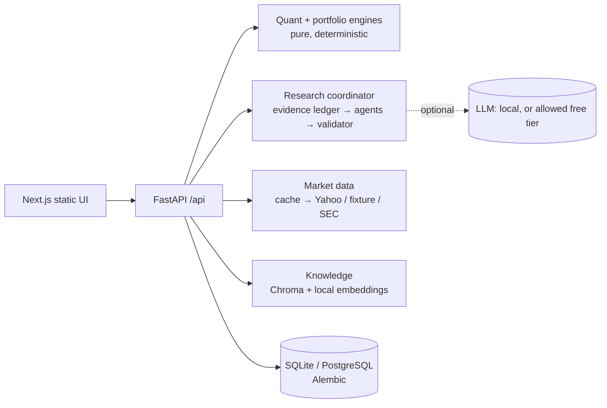

 <div align="center">

# 🦅 ARGUS
### Evidence-Grounded Quantitative Research Terminal

**Deterministic financial analytics. Evidence-cited research. Private portfolio and document workspace.**

[](https://www.python.org/)
[](https://fastapi.tiangolo.com/)
[](https://nextjs.org/)
[](https://www.typescriptlang.org/)
[](https://www.postgresql.org/)
[](#research-and-evidence)

[Overview](#overview) · [Features](#what-it-does) · [Architecture](#architecture) · [Quick Start](#quick-start-local-free) · [Testing](#testing-and-evaluation) · [Limitations](#status-and-known-limitations)

</div>

---

## Overview

**ARGUS is an evidence-grounded quantitative research terminal.** ARGUS computes market and portfolio analytics with a deterministic engine, assembles research reports in which every claim cites verifiable evidence, and keeps your portfolios, research history, and documents in a private workspace.

It runs entirely on free resources: free market data (Yahoo Finance via `yfinance`, SEC EDGAR), local embeddings, SQLite or PostgreSQL, and optional LLM synthesis through a local model or a free-tier endpoint (development uses Groq's free tier). No paid API is used or required.

> [!IMPORTANT]
> ARGUS is a research tool, not investment advice. Data from free sources may be delayed or incomplete, and historical statistics are not forecasts.

---

## Contents

- [What it does](#what-it-does)
- [Data freshness and correctness](#data-freshness-and-correctness)
- [The workspace (web UI)](#the-workspace-web-ui)
- [Architecture](#architecture)
- [Documentation](#documentation)
- [Quick start (local, free)](#quick-start-local-free)
- [Configuration](#configuration)
- [Testing and evaluation](#testing-and-evaluation)
- [Data sources and their limits](#data-sources-and-their-limits)
- [Project layout](#project-layout)
- [Status and known limitations](#status-and-known-limitations)

---

## What it does

| Workflow | What you get |
|---|---|
| **Asset analysis** | Delayed quote, profile, OHLCV history with dividends and splits, plus return/risk metrics (CAGR, volatility, Sharpe, Sortino, max drawdown with dates, historical VaR/CVaR, beta, alpha, correlation, tracking error, information ratio) and drawdown, rolling-volatility, and rolling-beta series against any benchmark. |
| **Portfolio lab** | Daily-rebalanced **or** buy-and-hold portfolios, per-asset contribution, Euler risk contribution, correlation matrix, diversification ratio, benchmark comparison, and a historical stress replay (GFC, 2011, Q4 2018, COVID, 2022), each with stated assumptions. |
| **Research reports** | Market, risk, news, document, and scenario sections whose claims each cite evidence ids (`M3`, `Q1`, `D2` …). A validator rejects claims with missing citations or numbers and dates not found in their evidence. Shows limitations, a stage trace, and live progress over SSE. |
| **Documents** | Upload PDFs, text, or HTML (or import SEC filings). Indexed locally with page-level provenance, searchable, cited in research, and private to your account. |
| **Workspace** | Accounts, saved portfolios (with optimistic concurrency), watchlist, research history. |

### Data freshness and correctness

Every market payload says where it came from and how fresh it is (`delayed`, `end_of_day`, or `fixture`, plus `cached` and `stale` flags).

**Undefined metrics are shown as undefined, never as zero.**

This distinction matters when working with delayed data, missing values, cached responses, or synthetic fixtures.

---

## The workspace (web UI)

Next.js 14 (App Router, static export) with TypeScript (strict), Tailwind, and `lightweight-charts`, served by the API process. Every chart is drawn from backend data, and every market value shows its freshness (`delayed`, `end of day`, `fixture`, `stale`).

### Workspace routes

| Route | Purpose |
|---|---|
| `/` | Market snapshot (SPY, QQQ, IWM, TLT, GLD), watchlist, recent research, backend capabilities |
| `/asset?symbol=X` | Quote header, price/volume chart (1M–MAX), profile stats; analytics tab with metric tooltips, cumulative vs benchmark, drawdown, rolling volatility and beta, return distribution with the VaR tail; news; SEC filings with import |
| `/portfolio` | Holdings editor, rebalancing model, window, and benchmark; growth, drawdown, risk-contribution, and correlation visuals; stress episodes; saved portfolios with version-checked updates |
| `/research` | Streamed progress with cancel; answer-first report with Fact/Analysis labels and clickable evidence citations; evidence panel (third-party flags, source links, document pages); generation badge, rejected claims, trace, export, history |
| `/documents` | Upload, library, passage search with an explicit insufficient-evidence state, SEC import; disabled with a progress notice while the embedding model downloads |
| `/login`, `/settings` | Accounts; backend URL, capabilities, metric glossary |

### Frontend commands

Run these commands in `frontend/`:

```bash
npm ci
npm run dev
npm run typecheck
npm run lint
npm test
npm run build
```

`npm run build` at the repository root builds the UI and copies it into `backend/app/static`.

For additional details, see [`frontend/README.md`](frontend/README.md).

---

## Architecture



### Core components

| Component | Responsibility |
|---|---|
| **Next.js workspace** | Market dashboard, asset analytics, portfolio tools, research interface, documents and account settings |
| **FastAPI** | API routes and coordination of application services |
| **Quant and portfolio engines** | Pure, deterministic financial calculations and portfolio analytics |
| **Research coordinator** | Evidence ledger, research agents, validation, report generation and progress streaming |
| **Market data** | Cache-backed market data using Yahoo Finance, fixtures and SEC sources |
| **Knowledge layer** | Chroma and local embeddings for indexed documents and retrieval |
| **Database layer** | SQLite or PostgreSQL, with Alembic migrations |
| **Optional LLM layer** | Local model or permitted free-tier endpoint for synthesis |

The LLM component is optional. Research generation and deterministic analytics are designed to operate with explicit handling for missing data and unavailable providers.

### Documentation

- [Architecture](docs/ARCHITECTURE.md)
- [Quant engine](docs/QUANT_ENGINE.md)
- [Research engine](docs/AGENT_ENGINE.md)
- [Knowledge layer](docs/KNOWLEDGE_LAYER.md)
- [API](docs/API.md)
- [Operations](docs/OPERATIONS.md)
- [Architecture Decision Records (ADRs)](docs/adr/)

---

## Quick start (local, free)

### Requirements

- Python 3.12+
- Node.js for the frontend
- Optional PostgreSQL; SQLite is the default database
- Optional local or free-tier LLM endpoint
- Internet access for initial model downloads and live market-data providers; fixture mode can be used for offline development with synthetic data

### 1. Start the backend

```bash
cd backend
python -m venv .venv
source .venv/Scripts/activate   # Git Bash on Windows; PowerShell: .venv\Scripts\Activate.ps1; macOS/Linux: source .venv/bin/activate
pip install -r requirements-dev.txt
uvicorn app.main:app --reload --port 8000
```

Open <http://localhost:8000/docs> for the API.

To work offline on synthetic data, set:

```bash
ARGUS_MARKET_DATA_PROVIDER=fixture
```

Fixture data is clearly labelled as not real prices.

### 2. Start the frontend

See [`frontend/README.md`](frontend/README.md).

To serve the built UI from the API on port 8000, run `npm run build` at the repository root.

### 3. Run with Docker

**Docker (ARGUS + PostgreSQL):**

```bash
docker compose up --build
```

Then open <http://localhost:8000>.

---

## Configuration

Everything is optional; defaults run locally for free. See the annotated [`backend/.env.example`](backend/.env.example).

### Notable settings

| Variable | Purpose |
|---|---|
| `ARGUS_MARKET_DATA_PROVIDER` | `yfinance` (default) or `fixture`. |
| `ARGUS_DATABASE_URL` | Unset for SQLite, or a `postgresql+psycopg://` URL. |
| `ARGUS_SEC_USER_AGENT` | Enables SEC EDGAR filings (the SEC requires a contact email in the User-Agent). |
| `ARGUS_LLM_PROVIDER=openai_compatible` | Enables the compatible LLM provider when configured with `ARGUS_LLM_MODEL` and optionally `ARGUS_LLM_API_KEY`. |

### Optional LLM synthesis

`ARGUS_LLM_PROVIDER=openai_compatible` + `ARGUS_LLM_MODEL` (+ `ARGUS_LLM_API_KEY`) enables optional synthesis via a local model (e.g. Ollama) or a free-tier endpoint (e.g. Groq).

Remote endpoints are refused unless:

```bash
ARGUS_LLM_ALLOW_REMOTE=true
```

Keep keys in `backend/.env`, which is gitignored.

No paid API is used or required; development uses Groq's free tier.

---

## Testing and evaluation

### Backend tests

```bash
cd backend
pytest -q                          # 313 offline tests (fixtures, temp DB, in-memory vectors)
python -m evals.research_eval      # grounding / failure-handling evaluation
ARGUS_RUN_LIVE_TESTS=1 pytest -m integration   # optional live Yahoo check
```

### Frontend tests

Frontend checks use strict TypeScript and Vitest:

```bash
npm run typecheck
npm test
```

The 33 Vitest tests cover the API client, CSRF/credentials, error envelopes, Retry-After, SSE parsing, and formatting rules such as "never label data real-time".

### Browser tests

Browser tests (Playwright, 18 tests) drive the real UI against a real backend started on fixture data with a fresh data directory, so they need no network, model, or credentials.

```bash
cd frontend
npm run build && npm run export:backend        # the backend serves this build
npx playwright install chromium                 # once; or reuse Chrome: E2E_BROWSER_CHANNEL=chrome
npm run test:e2e
```

They cover search and charts, asset analytics, provider-error and offline states, portfolio analysis and stress tests, cited research, sign-up, watchlist, saved portfolios, document upload, search, and deletion, sign-out and sign-in again, and phone-width layouts.

### Backend test coverage

The backend suite covers known-answer quant fixtures, portfolio invariants, provider retry, timeout, and caching semantics, the research validator (hallucinated numbers, fake citations, prompt injection, model outages), owner isolation for every workspace resource, CSRF and rate limits, document ingestion edge cases, SEC parsing, Alembic upgrade, drift, and downgrade, and state surviving a real process restart (SQLite, the on-disk vector index, and uploads).

### Continuous integration

CI (`.github/workflows/ci.yml`) also runs lint, the PostgreSQL migration test, the frontend checks, and a Docker build.

---

## Research and evidence

ARGUS separates deterministic quantitative computation from optional LLM-assisted synthesis.

Research reports can include market, risk, news, document, and scenario sections. Each claim cites evidence identifiers such as `M3`, `Q1`, or `D2`. A validator rejects claims when citations are missing or when the numbers and dates in a claim are not found in its cited evidence.

Reports also expose limitations, a stage trace, and live progress over Server-Sent Events (SSE).

The research evaluation command is:

```bash
python -m evals.research_eval
```

The evaluation and its current documented limitations are described in [docs/AGENT_ENGINE.md](docs/AGENT_ENGINE.md#evaluation-backendevalsresearch_evalpy).

### LLM evaluation caveat

LLM synthesis was evaluated on Groq's free tier (four runs of 4 cases; final run: 3/4 synthesized, 0 claims rejected, 0 bad claims shown).

That is a small sample, not a quality benchmark. The free tier allows about one LLM report per minute; beyond that, reports fall back to deterministic mode.

---

## Data sources and their limits

### Yahoo Finance (`yfinance`)

Free and unofficial; no SLA, rate limited, quotes may be delayed, and fundamentals can be missing or revised. ARGUS labels freshness, serves stale cached data only when marked stale, and reports outages as errors rather than empty data.

### SEC EDGAR

Official US filings; requires `ARGUS_SEC_USER_AGENT`; US registrants only.

### News

Yahoo search results. ARGUS shows headlines with publisher and date and does not infer sentiment.

### Analytics assumptions

Analytics use dividend-adjusted daily closes; they ignore costs, taxes, FX conversion, and survivorship bias (each stated in responses where relevant).

---

## Project layout

```text
backend/
  app/api/          HTTP routes          app/agents/      research pipeline
  app/quant/        metric functions     app/portfolio/   portfolio engine
  app/providers/    market data + SEC    app/knowledge/   documents & retrieval
  app/services/     use cases            app/db/, repositories/, migrations/
  app/llm/          local-model client   evals/           research evaluation
  tests/            offline test suite
frontend/           Next.js UI (static export)
docs/               architecture, engines, API, operations, ADRs
```

### Additional documentation

| Path | Contents |
|---|---|
| [`frontend/README.md`](frontend/README.md) | Frontend development and build instructions |
| [`backend/.env.example`](backend/.env.example) | Annotated backend configuration |
| [`docs/ARCHITECTURE.md`](docs/ARCHITECTURE.md) | Overall architecture |
| [`docs/QUANT_ENGINE.md`](docs/QUANT_ENGINE.md) | Quantitative engine |
| [`docs/AGENT_ENGINE.md`](docs/AGENT_ENGINE.md) | Research engine and evaluation |
| [`docs/KNOWLEDGE_LAYER.md`](docs/KNOWLEDGE_LAYER.md) | Document knowledge and retrieval |
| [`docs/API.md`](docs/API.md) | API reference |
| [`docs/OPERATIONS.md`](docs/OPERATIONS.md) | Deployment and operations |
| [`docs/adr/`](docs/adr/) | Architecture Decision Records |

---

## Status and known limitations

- **LLM evaluation is limited.** LLM synthesis was evaluated on Groq's free tier (four runs of 4 cases; final run: 3/4 synthesized, 0 claims rejected, 0 bad claims shown; see [docs/AGENT_ENGINE.md](docs/AGENT_ENGINE.md#evaluation-backendevalsresearch_evalpy)). That is a small sample, not a quality benchmark. The free tier allows about one LLM report per minute; beyond that, reports fall back to deterministic mode.
- **Initial embedding download.** The default ONNX embedding model (~80 MB) must download once; on slow networks pre-fetch it (`python -m app.knowledge.model_cache`) or use hash embeddings.
- **No OCR.** Scanned PDFs are reported as unreadable.
- **Single-instance behavior.** Caches and rate limits are per process (single-instance deployment).
- **Dark theme only.** The UI has a dark theme only.
- **Vercel deployment requires a separately hosted backend.** `vercel.json` deploys only the static UI. The UI calls the API on its own origin, so a Vercel deployment needs `NEXT_PUBLIC_API_URL` pointing at a separately hosted backend, that origin in `ARGUS_CORS_ORIGINS`, and cross-site cookies, which ARGUS does not configure (the session cookie is `SameSite=Lax`). The supported deployment is the single Docker image.
- **Docker and live PostgreSQL verification are pending in the documented environment.** Not built or run in this environment: the Docker image and live PostgreSQL (the CI workflow is configured to build the image and run the PostgreSQL migration test, but it has not run yet because these changes are uncommitted).

---

<div align="center">

### ARGUS
*Evidence-grounded quantitative research, with explicit provenance and limitations.*

</div>
