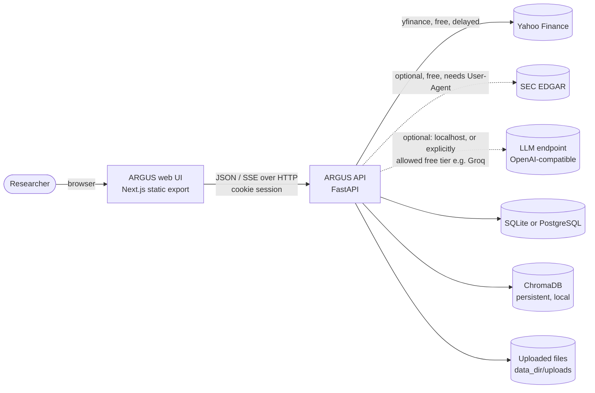
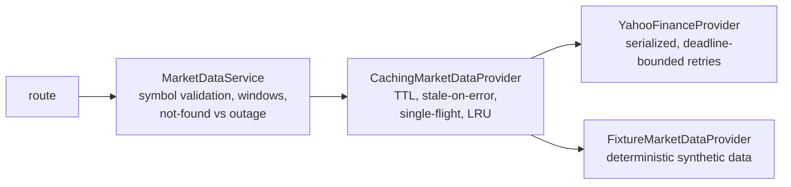
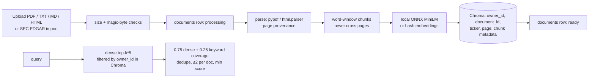

# ARGUS Architecture

This document describes the system **as implemented**. Diagrams use Mermaid.

## 1. System context



Everything runs on free resources. No paid API is required or supported: the
optional language model is a local OpenAI-compatible server or an explicitly
allowed free-tier endpoint (development uses Groq's free tier). Non-localhost
endpoints are refused unless `ARGUS_LLM_ALLOW_REMOTE=true`.

## 2. Components

| Layer | Package | Responsibility |
|---|---|---|
| Transport | `app/api/` | Routes, request/response schemas, auth dependencies. No business logic. |
| Schemas | `app/schemas/` | Pydantic contracts; domain objects are converted at the edge. |
| Composition | `app/core/container.py` | Builds long-lived collaborators once; tests inject fakes. |
| Cross-cutting | `app/core/` | Settings, error envelope, request-id middleware, logging, rate limiting, password/session primitives. |
| Market data | `app/providers/` | Provider protocol, Yahoo adapter, fixture provider, TTL cache, SEC EDGAR client. |
| Quant engine | `app/quant/` | Pure, deterministic metric functions. No I/O. |
| Portfolio engine | `app/portfolio/` | Pure portfolio construction, risk decomposition, stress replay. |
| Services | `app/services/` | Use cases: market data, asset analytics, portfolio, auth, documents. |
| Research | `app/agents/` | Evidence ledger, specialist agents, synthesis, validation, orchestration. |
| LLM | `app/llm/` | Narrow `generate_json` contract; local OpenAI-compatible provider. |
| Knowledge | `app/knowledge/` | Loading, chunking, embeddings, Chroma storage, hybrid retrieval. |
| Persistence | `app/db/`, `app/repositories/`, `migrations/` | ORM models, sessions, owner-scoped repositories, Alembic. |

Dependency direction is inward: `api → services/agents → quant/portfolio/providers/knowledge`.
`quant` and `portfolio` import nothing from the web, database, or provider layers.

## 3. Research request flow

```mermaid
sequenceDiagram
    participant UI
    participant API as /api/research(/stream)
    participant C as ResearchCoordinator
    participant M as Market + Analytics services
    participant R as Retriever (Chroma)
    participant A as Specialist agents
    participant L as LLM (optional; local or allowed free-tier)
    participant V as Validator
    UI->>API: POST {symbol, question}
    API->>C: research(...)
    par concurrently
        C->>M: price history → quant metrics (required)
        C->>M: quote, profile, news (optional)
    end
    C->>R: owner-scoped retrieval (signed-in users with documents)
    C->>C: build evidence ledger (Q/P/M/N/D/C ids)
    C->>A: market, risk, news, document, strategy agents
    opt LLM configured
        C->>L: evidence ledger + findings → JSON claims
        L-->>C: claims
    end
    C->>V: validate every claim (citations, numbers, dates)
    V-->>C: accepted claims + rejection log
    C-->>API: ResearchReport (+ trace, limitations)
    API-->>UI: JSON, or SSE step events then report
```

* Price history is **required**; its failure propagates (404 unknown symbol,
  422 insufficient data, 503/504 provider outage).
* Quote, profile, news, and retrieval are **optional**; a failure becomes a
  trace entry and a stated limitation.
* If the LLM is unavailable, returns invalid output, or fewer than four of its
  claims pass validation, the deterministic report is returned with the reason.

## 4. Market-data pipeline



Every payload carries `Provenance(provider, mode, retrieved_at, as_of, cached, stale)`;
`mode` is `delayed`, `end_of_day`, or `fixture`. Nothing is labelled real-time.

## 5. Document ingestion and retrieval



The `documents` row is the authority; Chroma is an index keyed by
`owner_id`/`document_id`. Parsing failures remove the row (422); storage or
indexing failures roll back chunks, file, and row (503) so a retry is a plain
re-upload. Deletion removes chunks first, so a failed delete never orphans
invisible chunks.

## 6. Persistence model

```mermaid
erDiagram
    users ||--o{ sessions : has
    users ||--o{ portfolios : owns
    portfolios ||--|{ portfolio_holdings : contains
    users ||--o{ watchlist_items : owns
    users ||--o{ research_reports : owns
    users ||--o{ documents : owns
    users { string id PK; string email UK; string password_hash }
    sessions { string token_hash PK; string user_id FK; datetime expires_at }
    portfolios { string id PK; string owner_id FK; string name; int version }
    portfolio_holdings { int id PK; string portfolio_id FK; string symbol; float weight }
    watchlist_items { int id PK; string owner_id FK; string symbol }
    research_reports { string id PK; string owner_id FK; string symbol; json report }
    documents { string id PK; string owner_id FK; string symbol; string content_sha256; string status }
```

Unique constraints: `users.email`, `(owner_id, name)` on portfolios,
`(portfolio_id, symbol)`, `(owner_id, symbol)` on watchlist items,
`(owner_id, content_sha256)` on documents. All child rows cascade on delete.
Portfolios use optimistic concurrency (`version_id_col`); saved research is an
immutable JSON snapshot including the evidence it cited.

## 7. Authentication and authorization boundary

* Opaque 256-bit session tokens; only their SHA-256 is stored. Delivered as an
  `HttpOnly; SameSite=Lax` cookie (`Secure` configurable) or as a Bearer token.
* Cookie-authenticated mutations must send `X-ARGUS-CSRF: 1`.
* Passwords use Argon2id; login equalizes timing for unknown accounts and
  returns one generic message; login and signup are rate limited (limiter
  eviction never drops a key that is at its limit, so cycling throwaway keys
  cannot reset a brute-force counter).
* Request bodies are capped by bytes actually received (chunked uploads
  included); unexpected errors return the standard envelope with a request id.
* Public routes that call data providers share a per-client rate limit.
* Every repository is constructed with the caller's `owner_id` and applies it
  to every query, so another user's object is indistinguishable from a missing
  one (404). Chroma retrieval filters on `owner_id` inside the vector store.
* Market data and analytics are public; workspace data requires sign-in.

## 8. Error semantics

| Situation | HTTP | `error.code` |
|---|---|---|
| Malformed body / field | 422 | `validation_error` |
| Invalid symbol, window, rate | 400 | `invalid_request` |
| Unknown symbol | 404 | `symbol_not_found` |
| Too little history | 422 | `insufficient_data` |
| Provider down / rate limited | 503 | `provider_unavailable` / `provider_rate_limited` |
| Provider timeout | 504 | `provider_timeout` |
| Not signed in / CSRF | 401 / 403 | `authentication_required` / `permission_denied` |
| Conflict (duplicate, stale version) | 409 | `conflict` |
| Upload too big / wrong type / unreadable | 413 / 415 / 422 | `payload_too_large` / `unsupported_media_type` / `document_unreadable` |
| Database down | 503 | `database_unavailable` |
| Unexpected | 500 | `internal_error` (no stack trace; quote `request_id`) |

## 9. Deliberate non-goals

No microservices, task queue, Redis, or event streaming: workloads are small
and single-process. In-memory caches and rate limiters are per process; a
multi-replica deployment would need a shared store. No autonomous agent loop:
research inputs are known in advance, so a fixed pipeline is cheaper, faster,
and easier to verify.
